# Sublimatio — Ephemeral Payload Buffer

**Sublimatio** adalah aplikasi fullstack *ephemeral buffer* berlatar cyberpunk/mesh-network yang dirancang untuk sinkronisasi data sementara (file, link URL, dan text snippets) antar perangkat. Setiap data (*payload*) disimpan secara volatil di memori RAM dengan hitungan mundur *circular Time-To-Live* (TTL). Saat TTL habis, payload akan mengalami *sublimasi* (dihapus permanen dari memori secara *zero-knowledge*).

Proyek ini dibangun menggunakan arsitektur modern fullstack:
- **Backend**: [NestJS](https://nestjs.com/) (TypeScript) dengan pola arsitektur **MVC (Model-View-Controller)**, Service dengan Dependency Injection, DTO Validation menggunakan `class-validator` & `ValidationPipe`, serta in-memory volatile buffer storage.
- **Frontend**: [React 18](https://react.dev/) + [Vite](https://vitejs.dev/) + [Tailwind CSS](https://tailwindcss.com/) dengan visual futuristik bertema ephemerality.

---

## Pemenuhan Tugas Bab 9: NestJS Dasar + Struktur MVC

| Poin Tugas | Implementasi di Proyek | Status |
|---|---|:---:|
| **1. Data Utama Aplikasi** | Entitas data utama adalah **Payload** (`src/payloads/entities/payload.entity.ts`). | Selesai |
| **2. Nest CLI Resource & Entity** | Dibuat menggunakan `nest g resource payloads` dengan >5 atribut bertipe data variatif: `string`, `number`, `boolean`, `enum`/literal. | Selesai |
| **3. Service CRUD Lengkap** | Diimplementasikan di `PayloadsService` (`create`, `findAll`, `findOne`, `update`, `remove`) disimpan dalam *in-memory array* volatil. | Selesai |
| **4. Controller & DI** | `PayloadsController` menangani method HTTP `GET`, `POST`, `PATCH`, `DELETE` via *Dependency Injection* tanpa instansiasi manual. | Selesai |
| **5. DTO & ValidationPipe** | `CreatePayloadDto` & `UpdatePayloadDto` menggunakan `@IsString`, `@IsNotEmpty`, `@MinLength`, `@IsIn`, `@IsNumber`, `@IsPositive`, `@IsOptional`, `@IsBoolean` dengan `ValidationPipe` global. | Selesai |
| **6. Exception NestJS** | Menangani `NotFoundException` (ID tidak ditemukan), `ConflictException` (nama duplikat di RAM), dan `BadRequestException` (konten/URL tidak valid). | Selesai |
| **7. Uji REST Client** | File spesifikasi & test koleksi `payloads.http` (disertai screenshot request & response setiap method). | Selesai |
| **8. Koneksi Fullstack** | Frontend React terhubung penuh ke backend NestJS via REST API untuk alur **GET, POST (tambah), PATCH (ubah), dan DELETE (hapus)**. | Selesai |

---

## Struktur Entitas Data Utama (`Payload`)

Entitas data utama didefinisikan pada file [`backend/src/payloads/entities/payload.entity.ts`](backend/src/payloads/entities/payload.entity.ts):

| Field | Tipe Data | Deskripsi |
|---|---|---|
| `id` | `string` | Identifier unik payload (contoh: `sub-f-01`, `sub-mwgf...`) |
| `name` | `string` | Nama label file, teks, atau bookmark link |
| `type` | `PayloadType` (`'file' \| 'link' \| 'text'`) | Tipe jenis payload ephemeral |
| `totalTTL` | `number` | Waktu simpan awal dalam satuan detik |
| `remainingTTL` | `number` | Sisa waktu sebelum otomatis disublimasikan dari RAM |
| `isPinned` | `boolean` | Flag proteksi sublimasi otomatis |
| `content` | `string` *(optional)* | Isi cuplikan teks atau representasi stream file |
| `url` | `string` *(optional)* | URL tujuan jika tipe payload adalah `link` |
| `device` | `string` | Perangkat asal pengirim (*origin peer*) |
| `size` | `string` *(optional)* | Ukuran data manusiawi (misal `184 KB`, `5.1 MB`) |
| `mime` | `string` *(optional)* | MIME format string (contoh: `application/json`, `text/plain`) |
| `hash` | `string` | Checksum integritas SHA-256 *zero-knowledge* |
| `createdAt` | `string` | Timestamp ISO 8601 saat payload masuk ke buffer |

---

## Daftar Endpoint REST API

Base URL: `http://localhost:3000`

| HTTP Method | Endpoint | Status Code | Deskripsi & Exception |
|---|---|---|---|
| `GET` | `/payloads` | `200 OK` | Mengambil seluruh daftar payload di RAM |
| `GET` | `/payloads/:id` | `200 OK` / `404 Not Found` | Mengambil satu payload berdasarkan ID unik (`NotFoundException`) |
| `POST` | `/payloads` | `201 Created` / `400 Bad Request` / `409 Conflict` | Menyimpan payload baru ke buffer RAM (`ConflictException`, `ValidationPipe`) |
| `PATCH` | `/payloads/:id` | `200 OK` / `404 Not Found` | Memperbarui sebagian field payload (`NotFoundException`, `ConflictException`) |
| `DELETE` | `/payloads/:id` | `200 OK` / `404 Not Found` | Menyublimasikan (menghapus permanen) data dari RAM (`NotFoundException`) |

---

## Dokumentasi & Screenshot Pengujian

Seluruh berkas gambar pengujian tersimpan pada direktori [`docs/screenshots/`](docs/screenshots/).

### A. Pengujian REST Client (Request & Response)

#### 1. `GET /payloads` — Mengambil Semua Payload (HTTP 200 OK)
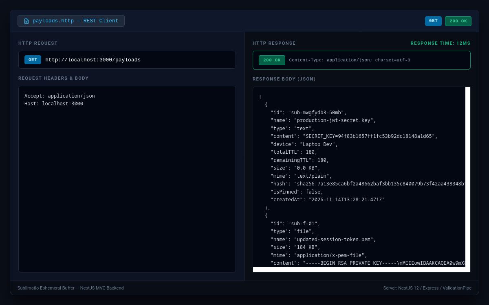

#### 2. `GET /payloads/:id` — Mengambil Satu Payload Berdasarkan ID (HTTP 200 OK)
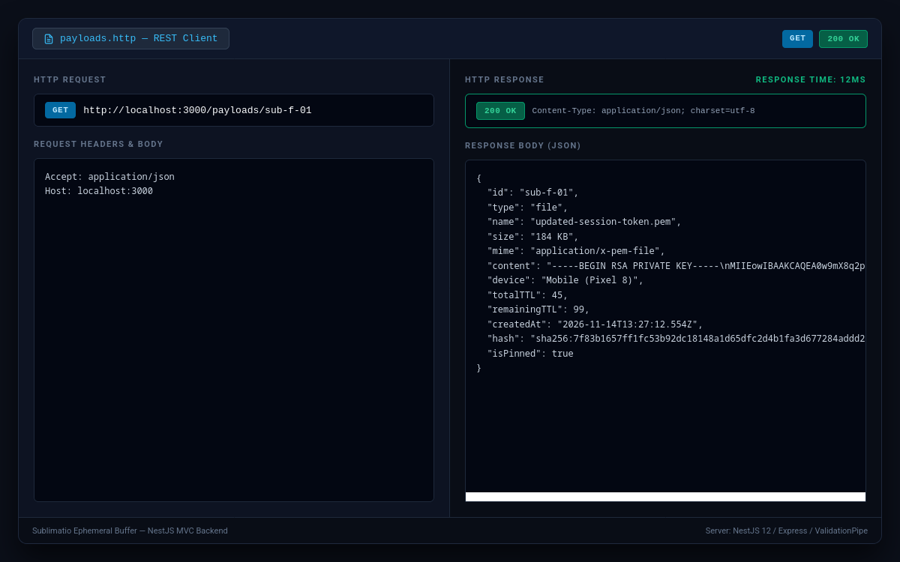

#### 3. `GET /payloads/:id` — Error Penanganan NotFoundException (HTTP 404 Not Found)
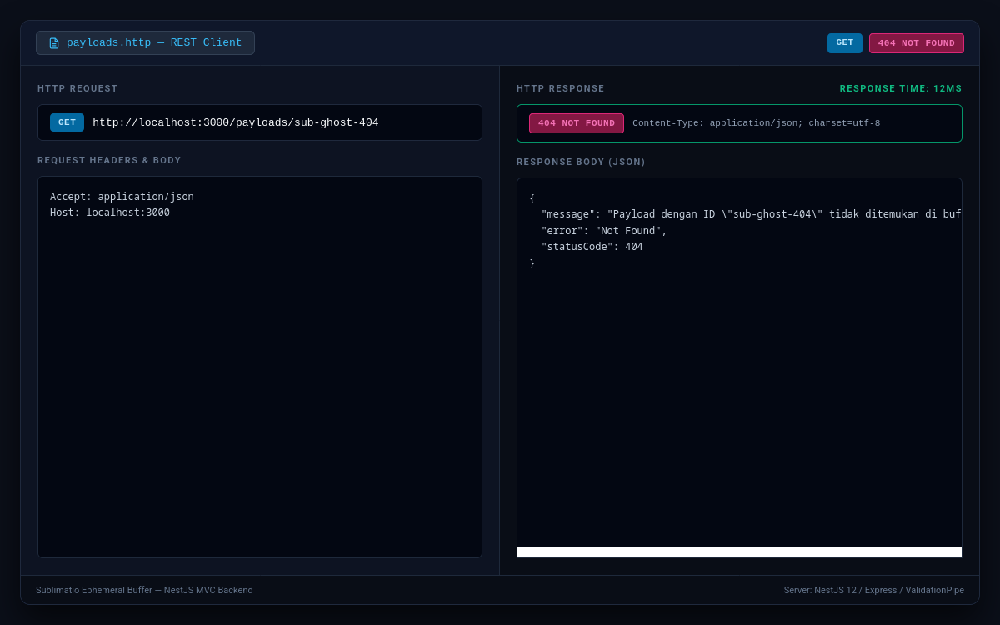

#### 4. `POST /payloads` — Menambah Payload Baru (HTTP 201 Created)
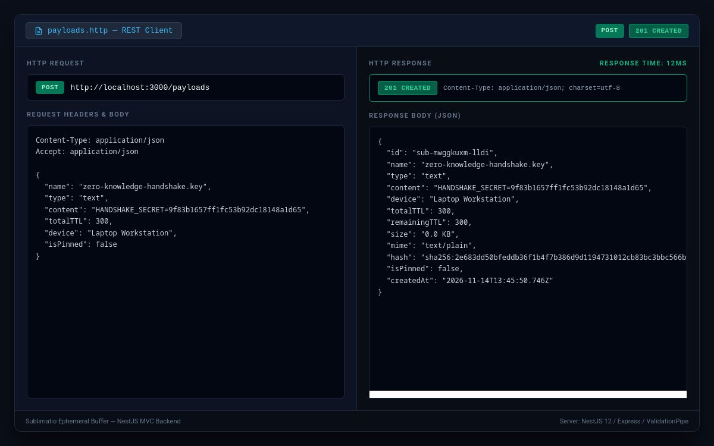

#### 5. `POST /payloads` — Error Validasi DTO via ValidationPipe (HTTP 400 Bad Request)
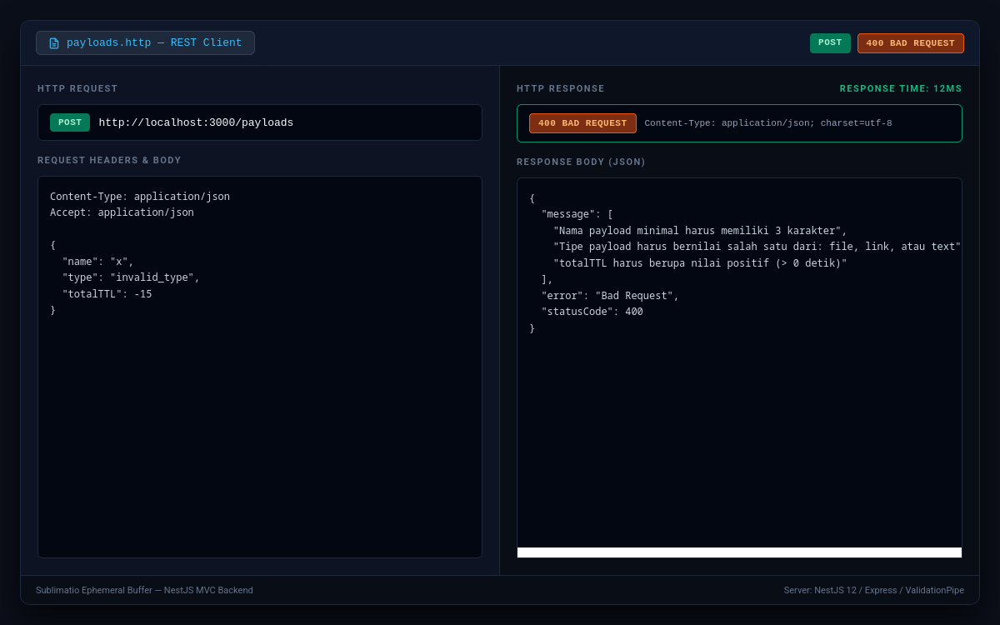

#### 6. `POST /payloads` — Error Penanganan ConflictException Data Duplikat (HTTP 409 Conflict)
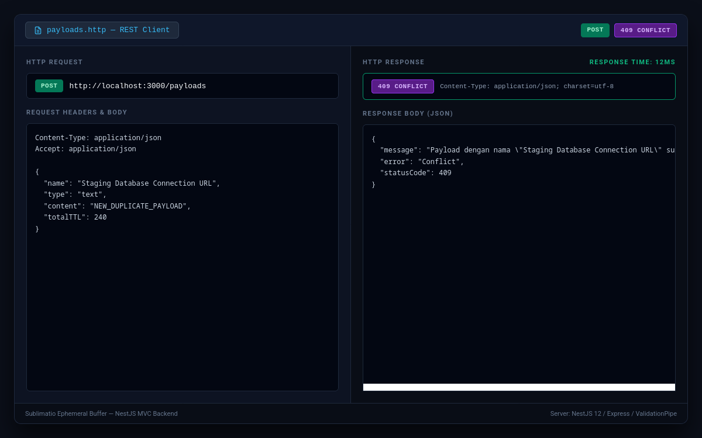

#### 7. `PATCH /payloads/:id` — Memperbarui Payload Sebagian (HTTP 200 OK)
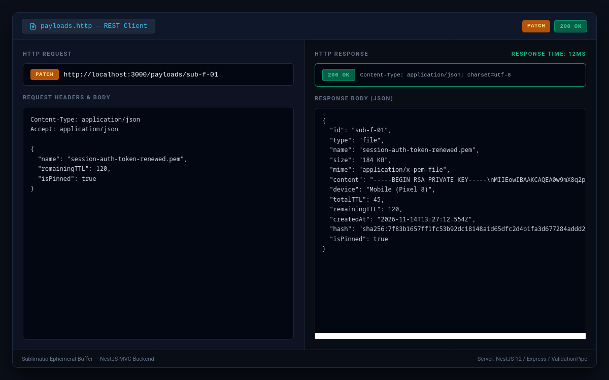

#### 8. `DELETE /payloads/:id` — Menghapus Payload dari RAM (HTTP 200 OK)
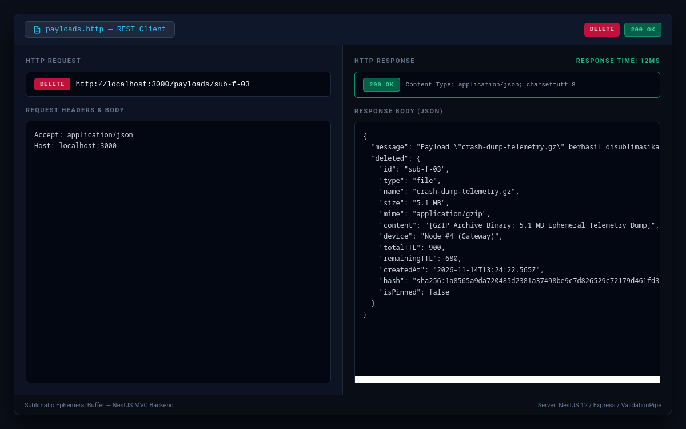

---

### B. Pengujian Sambungan Frontend ke Backend NestJS

#### 9. Dashboard Frontend Tersinkronisasi dengan Backend NestJS
Menampilkan daftar payload yang dimuat langsung dari server NestJS pada `http://localhost:3000/payloads` beserta toast notifikasi sukses:
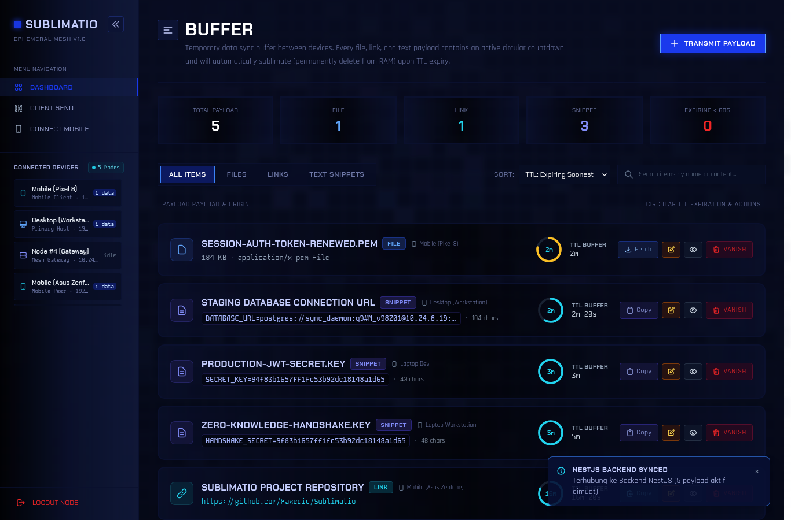

#### 10. Alur Tambah Data (*Transmit Payload* — POST)
Formulir input data payload baru yang divalidasi dan dikirim ke backend NestJS via `POST /payloads`:
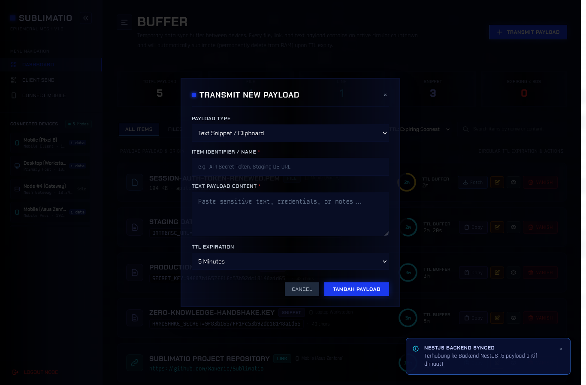

#### 11. Alur Ubah Data (*Edit Payload* — PATCH)
Modal edit data payload untuk memperbarui nama, sisa TTL, maupun status proteksi *pin* melalui endpoint `PATCH /payloads/:id`:
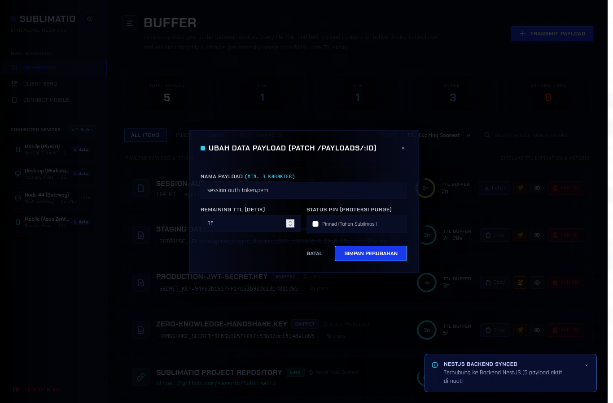

#### 12. Alur Hapus Data (*Manual Vanish / Sublimation* — DELETE)
Tindakan sublimasi manual payload dari RAM via `DELETE /payloads/:id` yang tercatat dalam log audit sublimasi:
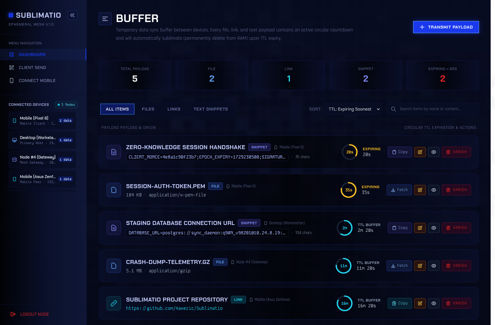

---

## Panduan Menjalankan Aplikasi

### 1. Prasyarat Lingkungan
- **Node.js**: v18+ (direkomendasikan v20+)
- **NPM** atau **PNPM**

### 2. Menjalankan Backend NestJS
Buka terminal dan masuk ke folder `backend/`:
```bash
cd backend
npm install
npm run start:dev
```
Server NestJS akan aktif di: **`http://localhost:3000`**

### 3. Menjalankan Frontend React Vite
Buka terminal baru di root proyek:
```bash
npm install
npm run dev
```
Aplikasi web Sublimatio akan aktif di: **`http://localhost:5173`** (atau `http://localhost:5173/dashboard`)

### 4. Menjalankan REST Client
Buka file [`payloads.http`](payloads.http) di VS Code dengan ekstensi **REST Client** (Huachao Mao) atau di JetBrains IDE, lalu klik **"Send Request"** di atas method yang ingin diuji.
Alternatif pengujian instan via terminal dapat menggunakan curl:
```bash
# GET Semua Payload
curl -i http://localhost:3000/payloads

# POST Tambah Payload
curl -i -X POST http://localhost:3000/payloads \
  -H "Content-Type: application/json" \
  -d '{"name":"api-token.key","type":"text","content":"TOKEN_XYZ","totalTTL":300}'

# PATCH Ubah Payload
curl -i -X PATCH http://localhost:3000/payloads/sub-f-01 \
  -H "Content-Type: application/json" \
  -d '{"name":"renewed-token.key","remainingTTL":600}'

# DELETE Hapus Payload
curl -i -X DELETE http://localhost:3000/payloads/sub-f-01
```
